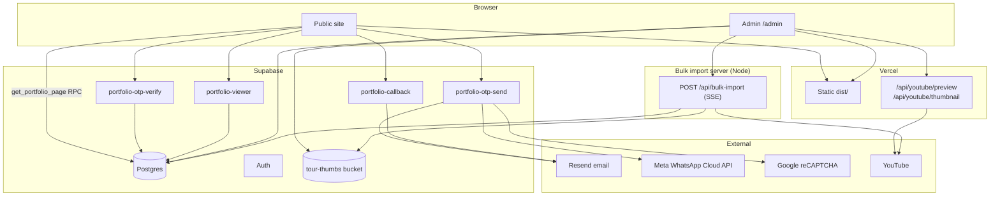

# NS Ventures Portfolio — Full Documentation

Marketing website and admin CMS for NS Ventures (real-estate visual production: property films, drone, and 360° virtual tours).

- **Production:** [projects.nsventures.in](https://projects.nsventures.in)
- **Repository (deploy source):** `nsventures/Nsv-Portfolio`, branch `main`
- **Last verified against code:** September 2026

Related guides:

- [Bulk Sheet Upload — Full Analysis](./BULK_UPLOAD_ANALYSIS.md)
- [WhatsApp Cloud API Setup](./WHATSAPP_CLOUD_API_SETUP.md)
- [Supabase setup quick-start](../supabase/README.md)

---

## Table of contents

1. [Overview](#1-overview)
2. [Architecture](#2-architecture)
3. [Tech stack](#3-tech-stack)
4. [Project structure](#4-project-structure)
5. [Routing](#5-routing)
6. [Public site](#6-public-site)
7. [Portfolio access (OTP gate)](#7-portfolio-access-otp-gate)
8. [Callback form](#8-callback-form)
9. [Admin panel](#9-admin-panel)
10. [Sort order and publish dates](#10-sort-order-and-publish-dates)
11. [YouTube preview and publish-date fetching](#11-youtube-preview-and-publish-date-fetching)
12. [Bulk upload](#12-bulk-upload)
13. [Supabase backend](#13-supabase-backend)
14. [Environment variables](#14-environment-variables)
15. [Local development](#15-local-development)
16. [Deployment](#16-deployment)
17. [npm scripts](#17-npm-scripts)
18. [Key source files](#18-key-source-files)
19. [Troubleshooting](#19-troubleshooting)
20. [Known gaps](#20-known-gaps)

---

## 1. Overview

| Area | What it does |
|------|--------------|
| **Public site** | Hero video, portfolio grid with Videos and Virtual tours tabs, state filter, infinite scroll |
| **Portfolio gate** | Visitors verify with a one-time code (email, plus WhatsApp when configured) before any video or tour opens |
| **Callback form** | Navbar "Get a callback" → notification email + lead row in `inquiries` |
| **Site protection** | In production, blocks copy, right-click, and common DevTools shortcuts |
| **Admin CMS** | Portfolio CRUD, sort order with site preview, cities, bulk CSV/Excel import |

### What is protected

- **Video and tour links are never in the public listing.** The listing RPC returns names, thumbnails, and labels only. Links come from the `portfolio-viewer` edge function, and only with a valid session token.
- **Admin** needs a Supabase Auth login **and** a row in `admin_users`. In production there is also a password screen in front of `/admin` (see [§9](#9-admin-panel)).

### Where each part runs

| Part | Host |
|------|------|
| React frontend (`dist/`) | Vercel |
| YouTube preview + thumbnail proxy (`/api/youtube/*`) | Vercel serverless functions |
| Database, Auth, Storage, Edge Functions | Supabase |
| Email | Resend (called from Supabase edge functions) |
| WhatsApp OTP | Meta WhatsApp Cloud API (called from Supabase edge functions) |
| Bulk import server | Separate long-running Node host, or locally via `npm run dev:all` |

---

## 2. Architecture



---

## 3. Tech stack

| Layer | Technology |
|-------|------------|
| Frontend | React 19, TypeScript 6, Vite 8 |
| Routing | React Router 7 |
| Styling | Tailwind CSS 4 |
| Animation / scroll | GSAP, Framer Motion, Lenis |
| Backend | Supabase (Postgres, Auth, Storage, Edge Functions on Deno) |
| Email | Resend |
| WhatsApp | Meta WhatsApp Cloud API (template message) |
| Bot protection | Google reCAPTCHA v3 |
| Spreadsheets | `xlsx` (parsed in the browser) |
| Thumbnails | `sharp` (WebP), Playwright (VR screenshots) |
| Hosting | Vercel |
| Analytics | `@vercel/analytics` |

---

## 4. Project structure

```
nsvportfolio/
├── api/youtube/              # Vercel serverless: preview.mjs, thumbnail.mjs
├── data/                     # Sample CSVs (youtube-bulk-sample.csv, tours.csv.example)
├── docs/                     # This documentation
├── public/                   # hero.mp4, mobilehero.mp4, logo, favicon, placeholder
├── scripts/                  # CLI utilities (backfill, delete, compress, import)
│   └── lib/                  # Shared: youtube-metadata, screenshots, thumbnail compression
├── server/
│   ├── bulk-import.mjs       # Bulk import HTTP server (SSE progress)
│   ├── Dockerfile            # Playwright image for the bulk server
│   └── lib/youtube-preview.mjs
├── supabase/
│   ├── migrations/           # 001–029 SQL migrations
│   ├── functions/            # Edge functions + _shared helpers
│   └── README.md
├── src/
│   ├── Root.tsx              # Router, analytics, auth-recovery redirect
│   ├── PublicApp.tsx         # Public page composition
│   ├── admin/                # Admin app (pages, components, api, lib, context)
│   ├── api/                  # Public API clients (listing, OTP, callback, viewer)
│   ├── components/           # layout/, sections/, ui/
│   ├── context/              # PortfolioAccessContext (gate + viewer)
│   ├── data/                 # Indian states, phone countries, static content
│   ├── hooks/                # usePortfolio, useLenis, useSiteProtection
│   ├── lib/                  # supabase client, access session, protection, helpers
│   └── types/
├── vercel.json               # SPA rewrite (everything except /api/*)
└── vite.config.ts            # Dev: /api/youtube/* middleware, /api/bulk-import proxy
```

---

## 5. Routing

### Top level (`src/Root.tsx`)

| Path | Renders | Notes |
|------|---------|-------|
| `/admin/*` | `AdminProductionGate` → `AdminApp` (lazy) | Needs `VITE_SUPABASE_*` |
| `/*` | `PublicApp` | Single scrolling page |

`Root.tsx` also listens for Supabase's `PASSWORD_RECOVERY` event and redirects to `/admin/login`, so password-reset links work even when they land on the homepage.

### Public site

No path routes. The portfolio tab is driven by the URL hash:

| Hash | Tab |
|------|-----|
| `#virtual-tours` | Virtual tours |
| anything else (e.g. `#video`) | Videos (default) |

### Admin (`src/admin/AdminApp.tsx`)

| URL | Page |
|-----|------|
| `/admin/login` | Login (email + password, password reset) |
| `/admin` | Dashboard |
| `/admin/tours` | Portfolio list (`?tab=video` / `?tab=virtual-tour`, `?focus=<id>`) |
| `/admin/tours/new` | Add tour / video |
| `/admin/tours/:id/edit` | Edit tour / video |
| `/admin/cities` | Cities |
| `/admin/bulk-upload` | Bulk import |

### Serverless endpoints

| Endpoint | Where | Purpose |
|----------|-------|---------|
| `POST /api/youtube/preview` | Vercel (`api/youtube/preview.mjs`), and Vite middleware in dev | Returns video ID, thumbnail URL, publish date |
| `GET /api/youtube/thumbnail?id=` | Vercel (`api/youtube/thumbnail.mjs`), and Vite middleware in dev | Proxies the YouTube poster so the admin can upload it (avoids CORS) |
| `POST /api/bulk-import` | Bulk import server only | Streams import progress |
| `GET /api/bulk-import/health` | Bulk import server only | `{ configured: true }` when the service role key is set |

`vercel.json` rewrites every non-`/api/` path to `index.html`.

---

## 6. Public site

### Page composition (`PublicApp.tsx`)

1. **Navbar** — logo, navigation, "Get a callback"
2. **Hero** — full-screen video (`hero.mp4`, `mobilehero.mp4` on mobile, `test.jpeg` poster)
3. **Portfolio** — Videos / Virtual tours tabs, state dropdown, infinite scroll
4. **Footer** and **FloatingActions** (WhatsApp, back to top)
5. **CursorFollower** — loaded when the browser is idle
6. **PortfolioAccessGateModal** and **PortfolioCallbackModal**

`useSiteProtection()` runs on the public site only. When `VITE_IS_PRODUCTION=true`, it blocks copy, right-click, and DevTools shortcuts, and shows an overlay if DevTools is detected.

### Listing data

```
usePortfolio()                          src/hooks/usePortfolio.ts
  → fetchPortfolioPage()                src/api/portfolio.ts
    → supabase.rpc('get_portfolio_page', {
        p_page, p_page_size, p_city, p_state, p_media_type, p_category })
```

- Page size: **24** (`PORTFOLIO_PAGE_SIZE`)
- Returns items **without links**, plus state/city/category counts, `noStateCount`, and pagination
- Items with no state appear only under **All states**
- Thumbnails: `{SUPABASE_URL}/storage/v1/object/public/tour-thumbs/{path}`

Tab order is described in [§10](#10-sort-order-and-publish-dates).

If Supabase is not configured, the listing returns an empty stub instead of failing.

### Opening an item

1. Card click → `PortfolioAccessContext.openPortfolioItem(entry)`
2. Not verified → the OTP gate opens and remembers the item
3. Verified → `PortfolioVideoModal` opens
4. The modal calls `portfolio-viewer` with `Authorization: Bearer <accessToken>`
5. The function returns `{ link, mediaType }` for a **published** item
6. The modal plays a YouTube embed, a native video, or a VR iframe. Videos show their publish month and year.

---

## 7. Portfolio access (OTP gate)

### Timing and storage (`src/lib/portfolioAccess.ts`)

| Setting | Value |
|---------|-------|
| `PORTFOLIO_ACCESS_VALIDATION_ENABLED` | `true` |
| `PORTFOLIO_ACCESS_TIMER_MS` | 18 seconds — the gate opens automatically after page load |
| Session length | **24 hours** (`PORTFOLIO_ACCESS_TTL_MS`, must match `ACCESS_TTL_SECONDS` on the server) |
| Storage key | `localStorage["nsv-portfolio-access-v3"]` |

Clicking a card before verifying opens the gate straight away.

### Step 1 — send the code (`portfolio-otp-send`)

The modal collects **name, email, and mobile number** (with country code) and a reCAPTCHA v3 token.

1. Validate inputs; verify reCAPTCHA (skipped on localhost or when `RECAPTCHA_SECRET_KEY` is unset)
2. Rate limits: 5 codes per hour per email and per phone; 60-second resend cooldown
3. Delete older unverified challenges for that email
4. Generate a 6-digit code, hash it with `OTP_HASH_SECRET`, store it in `portfolio_otp_challenges` (expires in 5 minutes)
5. **Send email via Resend — required.** If email fails, the challenge is deleted and the request fails.
6. **Send the same code on WhatsApp via Meta — best effort.** If WhatsApp is not configured or fails, the request still succeeds and returns `whatsappError`, which the modal shows.
7. Return masked email and phone, `emailSent`, `whatsappSent`, `whatsappError`

WhatsApp only sends when `WHATSAPP_TOKEN`, `WHATSAPP_PHONE_NUMBER_ID`, and `WHATSAPP_TEMPLATE_NAME` are all set on the edge function. See [WHATSAPP_CLOUD_API_SETUP.md](./WHATSAPP_CLOUD_API_SETUP.md).

### Step 2 — verify (`portfolio-otp-verify`)

1. Load the latest unverified challenge; check expiry and the attempt limit
2. Compare the hash; mark `verified_at`
3. Insert a lead in `inquiries` with `project_type = 'Portfolio viewer'`
4. Issue a **24-hour** signed token (`ACCESS_TOKEN_SECRET`, falling back to `OTP_HASH_SECRET`)

The browser saves it with `savePortfolioAccess()` and opens the item the visitor clicked.

### Using the session

`portfolio-viewer` checks the Bearer token. An invalid or expired token returns 401. The site then clears the stored session and shows the gate again.

---

## 8. Callback form

Navbar → `PortfolioCallbackModal` → `submitPortfolioCallback()` → edge function `portfolio-callback`:

1. Validate name, email, phone; verify reCAPTCHA
2. Email the team at `CALLBACK_NOTIFY_EMAIL` via Resend
3. Insert into `inquiries` with `project_type = 'Callback request'`

---

## 9. Admin panel

### Access layers

1. **Production password gate** (`AdminProductionGate`, `src/lib/adminGate.ts`) — only when `VITE_IS_PRODUCTION=true`. The password is `VITE_ADMIN_GATE_PASSWORD`. If that is unset in production, it falls back to a hard-coded default, so **always set it**. Unlock lasts for the browser tab session.
2. **Supabase Auth** — email and password at `/admin/login`
3. **Allowlist** — `useAdminAuth` checks `admin_users`. Users not on the list are signed out.

Adding an admin:

1. Supabase → Authentication → Users → Add user
2. SQL editor:

```sql
insert into public.admin_users (user_id, email)
values ('USER-UUID', 'name@nsventures.in')
on conflict (user_id) do nothing;
```

3. Add `https://projects.nsventures.in/admin/login` to Supabase Auth → URL Configuration → Redirect URLs (needed for password-reset links)

### Dashboard (`/admin`)

Counts: total items, videos, virtual tours, published.

### Portfolio list (`/admin/tours`)

- **Virtual tours** and **Videos** tabs. On first load it opens the tab with the newest item.
- Search (project, builder, city, slug), state filter (including "No state"), status filter (Live / Draft)
- Columns: Sort #, drag handle, thumbnail, project, builder, state, city, **Published** (Videos tab), status, actions
- Actions: Edit, Duplicate (copies the thumbnail, lands as a draft at #1), Delete (also removes the thumbnail)
- Sorting is covered in [§10](#10-sort-order-and-publish-dates)

### Add / edit (`/admin/tours/new`, `/admin/tours/:id/edit`)

| Field | Notes |
|-------|-------|
| Builder name | Optional label |
| Project name * | Also fills the URL slug for new items |
| City | Free-text label |
| URL slug * | Item ID; fixed after creation |
| Tour / video link * | A YouTube link switches Media type to Video automatically |
| State | Optional. Blank = listed only under All states |
| Media type | Virtual tour or Video |
| **Published date** | Videos only. `DD / MM / YYYY`, numbers only. Filled from YouTube when the fetch works; type it when it doesn't |
| Published on live site | Draft vs live |

**Thumbnail panel:**

- YouTube videos: the poster is previewed immediately and uploaded when you save
- Manual upload: JPG, PNG, or WebP up to 5 MB, compressed to WebP. On edit, a manual upload saves right away.
- VR screenshots are only generated by bulk upload

Unsaved form input is kept in `localStorage` (`admin-tour-form:new`, `admin-tour-form:edit:<id>`), so a refresh doesn't lose it.

### Cities (`/admin/cities`)

List with item counts; add (name + state), change state, show/hide, merge (moves items, then deletes the source city), delete.

### Bulk upload (`/admin/bulk-upload`)

See [§12](#12-bulk-upload).

---

## 10. Sort order and publish dates

Both tabs use the same system, stored in `portfolio_items.sort_order`.

### Changing order in admin

- Type a new **Sort #** or drag a row
- The item **moves** to that position and the rows in between shift by one. It does not swap. Example: moving #34 to #4 pushes the old #4–#33 down one place; #1–#3 and #35 onward stay where they are.
- A **site preview** opens showing the new order (text cards only, published items only — no thumbnails, to save bandwidth)
- **Confirm & apply** saves the whole tab as `0..n-1`. **Cancel** throws the change away. Nothing is saved before Confirm.
- Reordering is disabled while any search or filter is active
- New and duplicated items are placed at **#1** of their tab (`min(sort_order) - 1`)

### Public order

| Tab | Order | Needs migration |
|-----|-------|-----------------|
| Virtual tours | `sort_order` (matches admin) | **028** |
| Videos | `sort_order` (matches admin) | **029** |
| Mixed / no tab | VR by `created_at` desc, videos by `video_published_at` desc | — |

**029** first sets video `sort_order` from newest publish date, so the live Videos grid looks the same the moment it's applied. After that, admin Confirm controls the order.

> **Do not run `026_vr_tab_follows_sort_order.sql`.** It broke the site (`column "vr_sort" does not exist`). `027` restores the last good function if ever needed.

### Publish date

`video_published_at` is shown on video cards and in the viewer as month and year (for example "Aug 2026"). On save, the date comes from:

1. The date you typed, if you edited the field
2. Otherwise the YouTube-fetched date
3. Otherwise the existing stored date

---

## 11. YouTube preview and publish-date fetching

Flow: `TourFormPage` → `fetchYoutubePreview()` (`src/admin/api/youtubePreview.ts`) → `POST /api/youtube/preview` → `server/lib/youtube-preview.mjs` → `scripts/lib/youtube-metadata.mjs`.

The same handlers run on Vercel and in the Vite dev server, so single-item add/edit does **not** need the bulk import server.

`fetchYoutubeMetadata()` tries these in order and stops at the first date it finds:

1. **YouTube Data API** — only if `YOUTUBE_API_KEY` is set. This is the most reliable option.
2. **Innertube player API** — WEB, MWEB, WEB_EMBEDDED_PLAYER, ANDROID clients
3. **Channel RSS feed** — uses the channel ID from step 2 (or from oEmbed). Only covers the channel's ~15 newest videos.
4. **Watch-page scrape** — `itemprop`, embedded JSON, `ytInitialPlayerResponse`

From Vercel's servers, YouTube often returns player data **without** a date. Steps 3 and 4 are fallbacks for that. For older videos on Vercel, either set `YOUTUBE_API_KEY` or type the date in the **Published date** field.

Backfill dates for existing rows: `npm run backfill:youtube-dates`.

---

## 12. Bulk upload

Full detail: [BULK_UPLOAD_ANALYSIS.md](./BULK_UPLOAD_ANALYSIS.md).

### Flow

1. Choose the **Virtual tours** or **YouTube videos** tab
2. Add one or more batches. Each batch has an optional **State** (applied to every row) and a CSV/XLSX/XLS file
3. The file is parsed in the browser (`parseBulkSheet.ts`; first Excel sheet only)
4. Each batch is sent to `POST /api/bulk-import` with the admin's token (max 500 rows per request)
5. The server streams progress (`start`, `item`, `complete`, `warn`, `fatal`) and writes to Supabase with the service role

**Skip existing links** (on by default): existing links are skipped or get a light label update. Off: re-captures the thumbnail and updates the row.

### YouTube sheet format

| Column (header, case-insensitive) | Required | Used for |
|-----------------------------------|----------|----------|
| `Youtube Link` / `Link` / `URL` | Yes | Video URL |
| `Project` / `Project Name` / `Title` / `Name` | No | Display name |
| `Builder` | No | Builder label |
| `City` / `City Name` | No | City label |
| `Category` | No | Category |
| `Published Date` | No | `DDMMYYYY` (e.g. `10082026`). `10/08/2026`, ISO dates, and Excel date cells also work. Blank = fetch from YouTube |

A State column in the sheet is **ignored**; use the batch dropdown. Without a header row, columns are read as category, title, link.

Sample: `data/youtube-bulk-sample.csv`

```csv
Builder,Project,City,Category,Youtube Link,Published Date
NS Ventures,Connectivity Video,Goa,Promo,https://www.youtube.com/watch?v=iQ7ATM1kkas,10082026
```

### Virtual tour sheet format

`Name` + `Link` columns (or name in column A and link in column B with no header). Thumbnails are captured with Playwright, so the server needs Chromium.

### Where the bulk server runs

| Environment | How |
|-------------|-----|
| Local | `npm run dev:all` — Vite proxies `/api/bulk-import` to `:3001` |
| Production | A long-running host (Docker image `server/Dockerfile`), with `VITE_BULK_IMPORT_API_URL` set on Vercel. Vercel alone cannot run it. |

---

## 13. Supabase backend

### Tables

| Table | Purpose |
|-------|---------|
| `portfolio_items` | Videos and tours: `id`, `name`, `link`, `thumbnail_path`, `media_type`, `state`, `builder_name`, `project_name`, `city_label`, `city_id`, `category`, `is_published`, `sort_order`, `video_published_at`, timestamps |
| `cities` | `name`, `state`, `sort_order`, `is_active` |
| `inquiries` | Leads from the gate and the callback form, with CRM columns: `status` (`new` / `contacted` / `in_progress` / `closed`), `notes`, `viewed_at`, `updated_at` |
| `inquiry_status_history` | Audit trail of status changes (admin read only) |
| `admin_users` | Admin allowlist (`user_id` → `auth.users`) |
| `portfolio_otp_challenges` | OTP state; service role only |

`inquiries` is published to Supabase Realtime (migration 018).

### RPC `get_portfolio_page`

Security-definer function used by the public site. Parameters: `p_page`, `p_page_size` (max 100), `p_city`, `p_media_type`, `p_category`, `p_state` (`'__none__'` = items with no state only). Returns items without links, plus `total`, `hasMore`, `cityCounts`, `categoryCounts`, `stateCounts`, `cityStates`, `noStateCount`.

### Edge functions

| Function | Auth | Role |
|----------|------|------|
| `portfolio-otp-send` | Public (JWT verification off) | Create code, send email + WhatsApp |
| `portfolio-otp-verify` | Public | Verify code, record lead, issue session token |
| `portfolio-viewer` | Bearer session token | Return the link of a published item |
| `portfolio-callback` | Public | Notification email + lead |

Shared code: `supabase/functions/_shared/` (`portfolio-otp.ts`, `portfolio-session.ts`, `recaptcha.ts`).

```bash
npx supabase link --project-ref YOUR_REF
npx supabase functions deploy portfolio-otp-send --no-verify-jwt
npx supabase functions deploy portfolio-otp-verify --no-verify-jwt
npx supabase functions deploy portfolio-viewer --no-verify-jwt
npx supabase functions deploy portfolio-callback --no-verify-jwt
```

### Storage

Bucket **`tour-thumbs`** — public read; admin write via `is_admin()` policies. Files are WebP named after the item ID.

### Row-level security

| Table | Anonymous | Admin |
|-------|-----------|-------|
| `portfolio_items` | No direct access (RPC only) | Full |
| `cities` | Read active | Full |
| `inquiries` | Insert | Read, update, delete |
| `inquiry_status_history` | None | Read |
| `admin_users` | Read own row | Full |
| `portfolio_otp_challenges` | None | Service role only |

### Migrations

Run in order in the Supabase SQL editor. Several later files **replace** `get_portfolio_page`; the latest one applied wins.

| # | Summary |
|---|---------|
| 001 | Core schema, RLS, city seed, listing RPC, storage bucket |
| 002–004 | `category` column, category filter, counts per media type |
| 005–006 | `state` on cities, state counts |
| 007 | Item labels: state, builder, project, city label |
| 008 | Remove links from the public RPC |
| 009–010 | OTP challenges table, email index |
| 011 | Links only via the edge function |
| 012 | OTP delivery metadata |
| 013 | `video_published_at` |
| 014–015 | Videos newest-first, with state filter |
| 016 (`portfolio_otp_phone_only`) | Make OTP email nullable |
| 016 (`repair_sort_order`) | Give every item a unique `sort_order` |
| 017–021 | Inquiries CRM: status, notes, realtime, status history, `viewed_at` + backfill |
| 022–024 | No-state behaviour and `noStateCount` |
| 025 | VR by `created_at` desc |
| 026 | **Broken — do not run** |
| 027 | Restore of 025's function (safe fallback) |
| 028 | Public VR tab follows `sort_order` |
| 029 | Public Videos tab follows `sort_order` (seeded from publish date) |

---

## 14. Environment variables

A template is in `.env.example`. `VITE_*` values are baked in at build time — **redeploy after changing them**.

### Vercel — build time

| Variable | Required | Notes |
|----------|----------|-------|
| `VITE_SUPABASE_URL` | Yes | |
| `VITE_SUPABASE_ANON_KEY` | Yes | |
| `VITE_IS_PRODUCTION` | Production | `true` turns on site protection and the admin password gate |
| `VITE_ADMIN_GATE_PASSWORD` | Production | Admin gate password. Set it; otherwise a built-in default is used |
| `VITE_RECAPTCHA_SITE_KEY` | Recommended | reCAPTCHA v3 site key |
| `VITE_SKIP_RECAPTCHA` | No | `true` disables captcha in the browser |
| `VITE_BULK_IMPORT_API_URL` | For bulk upload | URL of the bulk import server |

### Vercel — runtime (serverless)

| Variable | Required | Notes |
|----------|----------|-------|
| `YOUTUBE_API_KEY` | Recommended | Reliable publish dates in `/api/youtube/preview` |

### Supabase edge function secrets

| Variable | Required | Notes |
|----------|----------|-------|
| `OTP_HASH_SECRET` | Yes | Hashes codes; also signs sessions if `ACCESS_TOKEN_SECRET` is unset |
| `ACCESS_TOKEN_SECRET` | No | Separate session-signing secret |
| `RESEND_API_KEY` | Yes | |
| `RESEND_FROM_EMAIL` | Yes | Default `NS Ventures <noreply@nsventures.in>` |
| `RESEND_DEV_MODE` | No | `true` = log the code instead of emailing |
| `CALLBACK_NOTIFY_EMAIL` | No | Callback recipient (default `prateek@nsventures.in`) |
| `WHATSAPP_TOKEN` | For WhatsApp | Meta permanent access token |
| `WHATSAPP_PHONE_NUMBER_ID` | For WhatsApp | |
| `WHATSAPP_TEMPLATE_NAME` | For WhatsApp | Approved authentication template |
| `WHATSAPP_TEMPLATE_LANG` | No | Default `en_US` |
| `WHATSAPP_TEMPLATE_PURPOSE` | No | Default `Login` |
| `WHATSAPP_DEV_MODE` | No | `true` = log instead of sending |
| `RECAPTCHA_SECRET_KEY` | Recommended | Unset = captcha check skipped |
| `RECAPTCHA_MIN_SCORE` | No | Default `0.5` |
| `RECAPTCHA_FORCE` | No | `true` = enforce on localhost too |

`SUPABASE_URL` and `SUPABASE_SERVICE_ROLE_KEY` are injected automatically.

### Bulk import server and CLI scripts (`.env.local` locally)

| Variable | Notes |
|----------|-------|
| `SUPABASE_URL` (or `VITE_SUPABASE_URL`) | |
| `SUPABASE_ANON_KEY` (or `VITE_SUPABASE_ANON_KEY`) | Verifies the admin's token |
| `SUPABASE_SERVICE_ROLE_KEY` | **Secret.** Never expose to the browser or prefix with `VITE_` |
| `IMPORT_PORT` / `PORT` | Default `3001` |
| `YOUTUBE_API_KEY` | Optional, better publish dates |

---

## 15. Local development

### Prerequisites

- Node.js 20+ (the dev scripts use `node --env-file`)
- A Supabase project with migrations applied
- `.env.local` created from `.env.example`

### Commands

```bash
npm install

npm run dev        # site + admin on :5173 (YouTube preview works here)
npm run dev:all    # also starts the bulk import server on :3001 (needed for bulk upload)
npm run dev:free   # free ports 5173 / 3001 if something is stuck
```

`npm run dev :all` (with a space) is a common typo; the dev runner detects it and starts `dev:all`.

### Local URLs

| URL | Purpose |
|-----|---------|
| `http://localhost:5173` | Public site |
| `http://localhost:5173/admin/login` | Admin |
| `http://localhost:3001/api/bulk-import/health` | Bulk server health |

### Testing tips

- `RESEND_DEV_MODE=true` / `WHATSAPP_DEV_MODE=true` on the edge functions → codes appear in the function logs
- reCAPTCHA is skipped automatically on localhost
- Site protection is off unless `VITE_IS_PRODUCTION=true`

---

## 16. Deployment

### A. Supabase (when schema or functions change)

1. Run new migrations in the SQL editor (latest: **028** and **029**)
2. Deploy the four edge functions (see [§13](#13-supabase-backend))
3. Set edge secrets ([§14](#14-environment-variables))
4. Create admin users + `admin_users` rows
5. Auth → URL Configuration: add `https://projects.nsventures.in/admin/login`

### B. Vercel (site + YouTube API)

- Vercel deploys automatically on every push to `main` of `nsventures/Nsv-Portfolio`. There is no staging branch.
- Build command `npm run build` (typecheck + Vite), output `dist`
- Set the variables from [§14](#14-environment-variables), then redeploy

Pushes to any other repository (for example a personal fork) do **not** deploy.

### C. Bulk import server (optional)

```bash
docker build -f server/Dockerfile -t nsv-bulk-import .
docker run -p 3001:3001 \
  -e SUPABASE_URL=... \
  -e SUPABASE_ANON_KEY=... \
  -e SUPABASE_SERVICE_ROLE_KEY=... \
  nsv-bulk-import
```

Then set `VITE_BULK_IMPORT_API_URL=https://your-import-host` on Vercel and redeploy. For videos only, a plain Node host running `npm run start:import` is enough; VR screenshots need the Docker image (Playwright).

---

## 17. npm scripts

| Script | What it does |
|--------|--------------|
| `dev` | Vite dev server |
| `dev:all` | Vite + bulk import server |
| `dev:import` | Bulk import server only (reads `.env.local`) |
| `start:import` | Bulk import server for production hosts |
| `dev:free` | Free dev ports |
| `build` | `tsc -b` + `vite build` |
| `preview` | Serve the built `dist/` |
| `lint` | ESLint |
| `backfill:youtube-dates` | Fill missing `video_published_at` |
| `compress:thumbnails` / `compress:thumbnails:dry` | Re-compress stored thumbnails |
| `delete:videos` | Delete all video items (service role) |
| `delete:vr-tours` | Delete all VR items |
| `delete:orphan-thumbs` | Remove thumbnails with no matching item |
| `import:tours` / `parse:tours` | Legacy CSV → local JSON tools |

The `delete:*` scripts are destructive and use the service role key. Double-check `.env.local` points at the right project before running them.

---

## 18. Key source files

| File | Role |
|------|------|
| `src/Root.tsx` | Routing, analytics, password-recovery redirect |
| `src/PublicApp.tsx` | Public page layout |
| `src/context/PortfolioAccessContext.tsx` | Gate timing, pending item, viewer |
| `src/lib/portfolioAccess.ts` | Session storage and timing constants |
| `src/lib/siteProtection.ts`, `src/hooks/useSiteProtection.ts` | Copy / DevTools protection |
| `src/lib/adminGate.ts`, `src/admin/components/AdminProductionGate.tsx` | Admin password gate |
| `src/api/portfolio.supabase.ts` | Listing RPC + viewer call |
| `src/api/portfolioOtp.ts`, `src/api/portfolioCallback.ts` | OTP and callback clients |
| `src/components/ui/PortfolioAccessGateModal.tsx` | OTP modal |
| `src/admin/api/adminPortfolio.ts` | Admin CRUD, reorder, thumbnails, cities |
| `src/admin/pages/ToursPage.tsx` | Portfolio list, Sort #, drag, confirm |
| `src/admin/components/VrSitePreview.tsx` | Sort preview modal (both tabs) |
| `src/admin/pages/TourFormPage.tsx` | Add / edit form |
| `src/admin/components/PublishedDateInput.tsx`, `src/lib/publishedDateParts.ts` | DD / MM / YYYY input and date parsing |
| `src/admin/lib/parseBulkSheet.ts` | CSV / Excel parsing |
| `src/admin/lib/bulkImport.ts`, `src/admin/context/BulkImportContext.tsx` | Bulk import client + job state |
| `api/youtube/*.mjs`, `server/lib/youtube-preview.mjs` | YouTube preview / thumbnail endpoints |
| `scripts/lib/youtube-metadata.mjs` | Publish-date fetching chain |
| `server/bulk-import.mjs` | Bulk import server |
| `supabase/functions/*/index.ts` | Edge functions |
| `supabase/functions/_shared/*.ts` | Email, WhatsApp, hashing, sessions, reCAPTCHA |

---

## 19. Troubleshooting

**Changes pushed but the site didn't update**
Check you pushed to `nsventures/Nsv-Portfolio` `main`, and that the Vercel build passed. A TypeScript error (for example an unused variable) fails `tsc -b` and blocks the deploy — run `npm run build` locally first.

**Email code not arriving**
Check `RESEND_API_KEY` and `RESEND_FROM_EMAIL` in Supabase secrets, the domain in Resend, and `RESEND_DEV_MODE` is not `true`.

**WhatsApp code not arriving (email works)**
Expected until all three `WHATSAPP_*` secrets are set. The modal shows the reason. See [WHATSAPP_CLOUD_API_SETUP.md](./WHATSAPP_CLOUD_API_SETUP.md).

**"Security check failed"**
reCAPTCHA token missing or score too low. Check `VITE_RECAPTCHA_SITE_KEY` matches `RECAPTCHA_SECRET_KEY`, and that the production domain is registered on the key.

**Portfolio item won't open after verifying**
Session expired (24 hours) → verify again. Otherwise check `portfolio-viewer` is deployed and the signing secret is the same for verify and viewer.

**Admin login fails**
User missing from `admin_users`, or wrong password. For reset links, the `/admin/login` redirect URL must be allowed in Supabase Auth.

**YouTube publish date missing**
See [§11](#11-youtube-preview-and-publish-date-fetching). Type the date in the form, or set `YOUTUBE_API_KEY` on Vercel.

**Public order doesn't match admin**
Migration 028 (VR) or 029 (Videos) not applied, or the change was never confirmed in the preview.

**Public site error "column vr_sort does not exist"**
Migration 026 was run. Run 029 (or 028) to replace the function.

**Bulk upload says server offline**
Locally: use `npm run dev:all`. Production: `VITE_BULK_IMPORT_API_URL` not set, host down, or `SUPABASE_SERVICE_ROLE_KEY` missing on the host.

---

## 20. Known gaps

| Item | Status |
|------|--------|
| `ProjectInquiryModal` | Mounted in `PublicApp` but nothing opens it; submit is a mock |
| `submitPortfolioAccessLead` (`src/api/inquiry.ts`) | Unused; OTP verify inserts the lead instead |
| `WhatWeOffer`, `OffsetCarousel` | Built but not on the homepage |
| Inquiries CRM | Database side exists (017–021); there is no admin page for it in this codebase |
| Empty `api/_lib`, `api/analytics`, `api/bulk-import` folders | Leftovers; safe to remove |
| Admin gate default password | Used if `VITE_ADMIN_GATE_PASSWORD` is unset in production |
